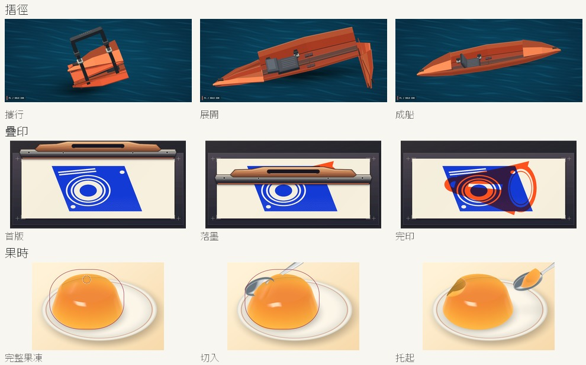

# 三件商業網站版頭驗收

以相同候選版本的中英桌機與手機畫面獨立審查。點選下表各格可以看到該作品的具體觀察，逐幀原圖與測量位於各作品的驗收檔。

候選 `5af20ebdb3d6f60dbbc4fa050678f05a9aca3c44`。[隔離瀏覽器驗收](https://github.com/KYStr/glossquote-visuals/actions/runs/44981579584) · [規則](../../../docs/M04-ACCEPTANCE.md)

| 規則 | 果時 | 疊印 | 摺徑 |
|---|---|---|---|
| ART-1 首屏辨識 | [通過](../../V008/5af20ebdb3d6f60dbbc4fa050678f05a9aca3c44/REVIEW.md#art-1-pass) | [通過](../../V009/5af20ebdb3d6f60dbbc4fa050678f05a9aca3c44/REVIEW.md#art-1-pass) | [通過](../../V010/5af20ebdb3d6f60dbbc4fa050678f05a9aca3c44/REVIEW.md#art-1-pass) |
| ART-2 材質與動作 | [通過](../../V008/5af20ebdb3d6f60dbbc4fa050678f05a9aca3c44/REVIEW.md#art-2-pass) | [通過](../../V009/5af20ebdb3d6f60dbbc4fa050678f05a9aca3c44/REVIEW.md#art-2-pass) | [通過](../../V010/5af20ebdb3d6f60dbbc4fa050678f05a9aca3c44/REVIEW.md#art-2-pass) |
| ART-3 作品辨識 | [通過](../../V008/5af20ebdb3d6f60dbbc4fa050678f05a9aca3c44/REVIEW.md#art-3-pass) | [通過](../../V009/5af20ebdb3d6f60dbbc4fa050678f05a9aca3c44/REVIEW.md#art-3-pass) | [通過](../../V010/5af20ebdb3d6f60dbbc4fa050678f05a9aca3c44/REVIEW.md#art-3-pass) |
| GPU-1 即時輸出 | [通過](../../V008/5af20ebdb3d6f60dbbc4fa050678f05a9aca3c44/REVIEW.md#gpu-1-pass) | [通過](../../V009/5af20ebdb3d6f60dbbc4fa050678f05a9aca3c44/REVIEW.md#gpu-1-pass) | [通過](../../V010/5af20ebdb3d6f60dbbc4fa050678f05a9aca3c44/REVIEW.md#gpu-1-pass) |
| GPU-2 控制與凍結 | [通過](../../V008/5af20ebdb3d6f60dbbc4fa050678f05a9aca3c44/REVIEW.md#gpu-2-pass) | [通過](../../V009/5af20ebdb3d6f60dbbc4fa050678f05a9aca3c44/REVIEW.md#gpu-2-pass) | [通過](../../V010/5af20ebdb3d6f60dbbc4fa050678f05a9aca3c44/REVIEW.md#gpu-2-pass) |
| PERF-1 畫面更新 | [通過](../../V008/5af20ebdb3d6f60dbbc4fa050678f05a9aca3c44/REVIEW.md#perf-1-pass) | [通過](../../V009/5af20ebdb3d6f60dbbc4fa050678f05a9aca3c44/REVIEW.md#perf-1-pass) | [通過](../../V010/5af20ebdb3d6f60dbbc4fa050678f05a9aca3c44/REVIEW.md#perf-1-pass) |
| PERF-2 資源與生命週期 | [通過](../../V008/5af20ebdb3d6f60dbbc4fa050678f05a9aca3c44/REVIEW.md#perf-2-pass) | [通過](../../V009/5af20ebdb3d6f60dbbc4fa050678f05a9aca3c44/REVIEW.md#perf-2-pass) | [通過](../../V010/5af20ebdb3d6f60dbbc4fa050678f05a9aca3c44/REVIEW.md#perf-2-pass) |
| UI-1 版面 | [通過](../../V008/5af20ebdb3d6f60dbbc4fa050678f05a9aca3c44/REVIEW.md#ui-1-pass) | [通過](../../V009/5af20ebdb3d6f60dbbc4fa050678f05a9aca3c44/REVIEW.md#ui-1-pass) | [通過](../../V010/5af20ebdb3d6f60dbbc4fa050678f05a9aca3c44/REVIEW.md#ui-1-pass) |
| UI-2 輸入與可及性 | [通過](../../V008/5af20ebdb3d6f60dbbc4fa050678f05a9aca3c44/REVIEW.md#ui-2-pass) | [通過](../../V009/5af20ebdb3d6f60dbbc4fa050678f05a9aca3c44/REVIEW.md#ui-2-pass) | [通過](../../V010/5af20ebdb3d6f60dbbc4fa050678f05a9aca3c44/REVIEW.md#ui-2-pass) |
| BIZ-1 商品決策 | [通過](../../V008/5af20ebdb3d6f60dbbc4fa050678f05a9aca3c44/REVIEW.md#biz-1-pass) | [通過](../../V009/5af20ebdb3d6f60dbbc4fa050678f05a9aca3c44/REVIEW.md#biz-1-pass) | [通過](../../V010/5af20ebdb3d6f60dbbc4fa050678f05a9aca3c44/REVIEW.md#biz-1-pass) |
| BIZ-2 客戶流程 | [通過](../../V008/5af20ebdb3d6f60dbbc4fa050678f05a9aca3c44/REVIEW.md#biz-2-pass) | [通過](../../V009/5af20ebdb3d6f60dbbc4fa050678f05a9aca3c44/REVIEW.md#biz-2-pass) | [通過](../../V010/5af20ebdb3d6f60dbbc4fa050678f05a9aca3c44/REVIEW.md#biz-2-pass) |
| FALL-1 降級首屏 | [通過](../../V008/5af20ebdb3d6f60dbbc4fa050678f05a9aca3c44/REVIEW.md#fall-1-pass) | [通過](../../V009/5af20ebdb3d6f60dbbc4fa050678f05a9aca3c44/REVIEW.md#fall-1-pass) | [通過](../../V010/5af20ebdb3d6f60dbbc4fa050678f05a9aca3c44/REVIEW.md#fall-1-pass) |
| FALL-2 錯誤復原 | [通過](../../V008/5af20ebdb3d6f60dbbc4fa050678f05a9aca3c44/REVIEW.md#fall-2-pass) | [通過](../../V009/5af20ebdb3d6f60dbbc4fa050678f05a9aca3c44/REVIEW.md#fall-2-pass) | [通過](../../V010/5af20ebdb3d6f60dbbc4fa050678f05a9aca3c44/REVIEW.md#fall-2-pass) |
| SHIP-1 來源與隱私 | [通過](../../V008/5af20ebdb3d6f60dbbc4fa050678f05a9aca3c44/REVIEW.md#ship-1-pass) | [通過](../../V009/5af20ebdb3d6f60dbbc4fa050678f05a9aca3c44/REVIEW.md#ship-1-pass) | [通過](../../V010/5af20ebdb3d6f60dbbc4fa050678f05a9aca3c44/REVIEW.md#ship-1-pass) |

## 美術細則

| 觀察點 | 果時 | 疊印 | 摺徑 |
|---|---|---|---|
| 輪廓與層次 | [通過](../../V008/5af20ebdb3d6f60dbbc4fa050678f05a9aca3c44/REVIEW.md#silhouette-pass) | [通過](../../V009/5af20ebdb3d6f60dbbc4fa050678f05a9aca3c44/REVIEW.md#silhouette-pass) | [通過](../../V010/5af20ebdb3d6f60dbbc4fa050678f05a9aca3c44/REVIEW.md#silhouette-pass) |
| 邊緣與收邊 | [通過](../../V008/5af20ebdb3d6f60dbbc4fa050678f05a9aca3c44/REVIEW.md#finish-pass) | [通過](../../V009/5af20ebdb3d6f60dbbc4fa050678f05a9aca3c44/REVIEW.md#finish-pass) | [通過](../../V010/5af20ebdb3d6f60dbbc4fa050678f05a9aca3c44/REVIEW.md#finish-pass) |
| 無字動作敘事 | [通過](../../V008/5af20ebdb3d6f60dbbc4fa050678f05a9aca3c44/REVIEW.md#narrative-pass) | [通過](../../V009/5af20ebdb3d6f60dbbc4fa050678f05a9aca3c44/REVIEW.md#narrative-pass) | [通過](../../V010/5af20ebdb3d6f60dbbc4fa050678f05a9aca3c44/REVIEW.md#narrative-pass) |
| 物件與動作連續 | [通過](../../V008/5af20ebdb3d6f60dbbc4fa050678f05a9aca3c44/REVIEW.md#continuity-pass) | [通過](../../V009/5af20ebdb3d6f60dbbc4fa050678f05a9aca3c44/REVIEW.md#continuity-pass) | [通過](../../V010/5af20ebdb3d6f60dbbc4fa050678f05a9aca3c44/REVIEW.md#continuity-pass) |
| 材質表現 | [通過](../../V008/5af20ebdb3d6f60dbbc4fa050678f05a9aca3c44/REVIEW.md#material-pass) | [通過](../../V009/5af20ebdb3d6f60dbbc4fa050678f05a9aca3c44/REVIEW.md#material-pass) | [通過](../../V010/5af20ebdb3d6f60dbbc4fa050678f05a9aca3c44/REVIEW.md#material-pass) |
| 跨畫面品質 | [通過](../../V008/5af20ebdb3d6f60dbbc4fa050678f05a9aca3c44/REVIEW.md#fidelity-pass) | [通過](../../V009/5af20ebdb3d6f60dbbc4fa050678f05a9aca3c44/REVIEW.md#fidelity-pass) | [通過](../../V010/5af20ebdb3d6f60dbbc4fa050678f05a9aca3c44/REVIEW.md#fidelity-pass) |

## 三件主視覺

[去字首看觀察](FIRST-VIEW.md) · [如何調整連續錄影](../4c732a2250bbd834628f7a6c8cce1a2712b0ec1a/REVIEW.md)

## 取證環境

GPU 實測使用 GitHub 託管 Windows 瀏覽器；手機欄位為觸控視口模擬。原生手機的顯示器、耗電與實體 GPU 表現仍需實機資料。

[首次候選的收邊退修與原尺寸對照](../a7bebb7512a50a55ca48c69a048a91bc2e9e9483/REVIEW.md)
